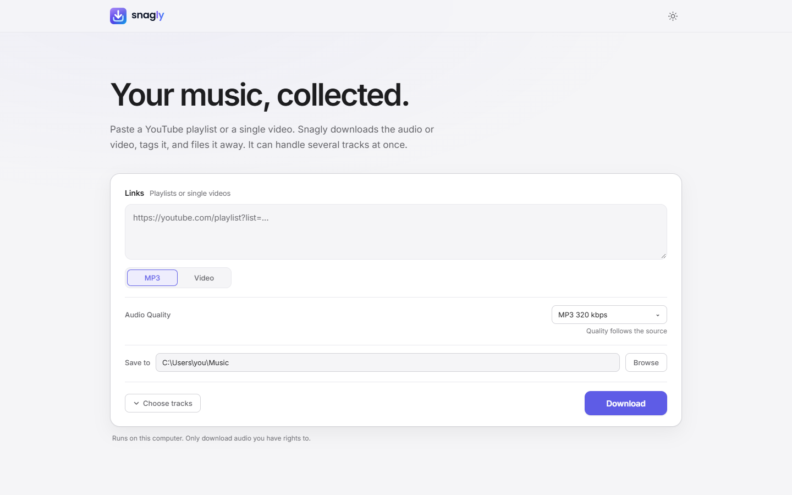

<p align="center">
  <picture>
    <source media="(prefers-color-scheme: dark)" srcset="public/assets/logo-dark.svg">
    
  </picture>
</p>

<p align="center">
  <strong>YouTube playlists → a tidy, tagged music library.</strong><br>
  Audio in MP3, FLAC, Opus or M4A. Video as MP4 up to 4K. Local, fast, no account.
</p>

<p align="center">
  
  
  
  
</p>

<p align="center">
  
</p>

Snagly is a small local web app that turns YouTube playlist links into a properly
named, tagged music library — or downloads them as MP4 video up to 4K. It runs on
your machine only, listens on `127.0.0.1`, and stores everything in plain JSON.
There is no npm install and no build step.

## Features

**Downloading**
- Playlists **and** single videos, several links at a time
- Audio: MP3 320 kbps, MP3 V0 (VBR), FLAC, Opus, M4A/AAC, or best available
- Video: MP4 at 360p, 480p, 720p, 1080p, 1440p or 2160p (4K), with quality
  ceilings so a 1080p source still downloads cleanly in a 4K batch
- Pick exactly which tracks to download — checkboxes, a range like `1-5, 8, 12`,
  per-playlist All/None, and a track filter
- Parallel downloads in a worker pool (5 by default)
- Resume-friendly: existing files are detected and skipped
- Pause, cancel, and retry only the failed tracks

**Library**
- Every playlist becomes a folder named after the playlist title
- Tracks are numbered `01 - Title.mp3`; single videos keep `Title [id]`
- Cover art, title, artist and album embedded into each file
- Filmstrip library with search, status filter and sorting
- Open folder, retry failed, remove from library, edit tags
- Export your download history as JSON

**Live progress**
- Server-sent events stream a live row per active track: phase, percentage,
  transfer speed and time remaining
- A waveform in the activity strip fills as tracks complete
- Automatic back-off when YouTube starts throttling
- Playlist metadata is cached for 24 hours, so re-adding a playlist is instant

**Small things**
- Light and dark themes
- Browser sign-in cookies are reused automatically (Chrome, Edge or Firefox)
- Friendly error messages for the usual YouTube sign-in checks

## Requirements

| Requirement | Notes |
|---|---|
| **Windows 10/11** | The app uses winget's install paths, `explorer.exe`, and the Windows folder picker |
| **Node.js 18+** | No npm packages are needed |
| **yt-dlp** | Installed through winget |
| **FFmpeg** | Installed through winget; used for conversion, merging and tagging |
| **Chrome / Edge / Firefox** | Optional, but recommended so yt-dlp can reuse your YouTube sign-in |

Install the two command-line tools:

```powershell
winget install --id yt-dlp.yt-dlp -e
winget install --id yt-dlp.FFmpeg -e
```

Snagly finds them automatically in the standard winget package folder, so no
PATH changes are needed.

## Run it

Double-click **`start.bat`**, or from a terminal:

```powershell
node server.js
```

Then open <http://localhost:4173>. To stop it, close the window or press `Ctrl+C`.

To use a different port:

```powershell
$env:REEL_PORT = 5000; node server.js
```

## Using Snagly

1. Paste one or more playlist or video links, one per line.
2. Choose **MP3** or **Video**, then pick a quality. Only the options for the
   active mode are shown.
3. Set **Save to** — it defaults to your Music folder.
4. Optionally open **Choose tracks** to preview the playlist and select a subset.
5. Press **Download**.

Finished files land in `<save folder>\<playlist title>\`. The activity panel
shows overall progress and a live row for every active track. Completed
playlists appear in the Library, where you can open their folder, retry failures,
or edit their tags.

Downloaded tracks are recorded in `data/state.json`, so adding the same playlist
again skips anything that already exists.

## How it works

```
Browser ──HTTP + SSE──► server.js ──► engine.js ──spawn──► yt-dlp
                          │              │                 │
                       public/        data/*.json       FFmpeg
```

- **`server.js`** is a dependency-free HTTP server. It serves the UI, exposes a
  small JSON API, opens folders in Explorer, and streams progress over SSE.
- **`engine.js`** owns the job queue. It probes links with `yt-dlp`, expands
  playlists, runs a worker pool of separate `yt-dlp` processes, parses their
  progress output, writes ID3/FLAC tags through FFmpeg, and keeps state on disk.
- **`public/`** is a plain HTML/CSS/JS interface — no framework, no bundler.

The slow part of `yt-dlp` on YouTube is per-video setup (player API calls and bot
checks), not the transfer itself. Snagly hides that latency by running several
tracks at once, reusing browser cookies, caching playlist metadata, and slowing
down automatically if YouTube pushes back.

## Project layout

| Path | Purpose |
|---|---|
| `server.js` | HTTP server, JSON API, SSE endpoint, folder opener |
| `engine.js` | Job queue, worker pool, yt-dlp/FFmpeg orchestration, tagging, resume |
| `public/index.html` | Interface markup |
| `public/app.js` | UI state, rendering, API calls, live progress |
| `public/styles.css` | Design system and layout |
| `public/assets/` | Logo, icon and favicon |
| `start.bat` | Windows launcher |
| `DESIGN.md` | Visual direction and design decisions |
| `data/state.json` | Jobs and the record of downloaded tracks (created at runtime, git-ignored) |
| `data/cache/` | Cached playlist metadata and format probes (git-ignored) |

## HTTP API

The UI talks to the server through these endpoints. They are all local-only.

<details>
<summary>Show endpoints</summary>

| Method | Endpoint | Purpose |
|---|---|---|
| `GET` | `/api/status` | Tools, root folder, workers, pause state |
| `GET` | `/api/events` | SSE stream of job and progress updates |
| `GET` | `/api/jobs` | All jobs plus current status |
| `POST` | `/api/jobs` | Create jobs from `{ items: [{ url, selected }], root, format, isVideo }` |
| `POST` | `/api/jobs/:id/retry` | Retry failed tracks in a job |
| `POST` | `/api/jobs/:id/cancel` | Cancel a running job |
| `DELETE` | `/api/jobs/:id` | Remove a job from the library |
| `POST` | `/api/preview` | Read links and return playlists/tracks without downloading |
| `POST` | `/api/probe` | Probe available formats for one URL |
| `GET` | `/api/formats` | Audio format options |
| `GET` | `/api/video-formats` | Video quality options |
| `POST` | `/api/pause` | `{ paused: true \| false }` |
| `POST` | `/api/settings` | `{ workers, useCookies, isVideo }` |
| `POST` | `/api/tags/edit` | `{ file, tags }` to rewrite a file's metadata |
| `GET` | `/api/history` | Exportable download history |
| `POST` | `/api/cache/clear` | Delete cached playlist metadata |
| `POST` | `/api/open` | `{ path }` — open a library folder in Explorer |
| `POST` | `/api/browse` | Folder picker placeholder for non-Chromium browsers |

</details>

## Troubleshooting

**"YouTube asked for a sign-in check"**
Sign in to YouTube in Chrome or Edge, then retry the failed tracks. Snagly passes
your browser cookies to yt-dlp automatically when it finds a browser profile.
Updating yt-dlp often fixes this too:

```powershell
winget upgrade --id yt-dlp.yt-dlp -e
```

**"Tool not found" / downloads do nothing**
Make sure both winget packages are installed and restart Snagly:

```powershell
winget list --id yt-dlp.yt-dlp
winget list --id yt-dlp.FFmpeg
```

**Port 4173 is already in use**
Start with another port using `REEL_PORT`, as shown above.

**A track is stuck at 0%**
YouTube is probably throttling the request. Snagly slows itself down
automatically; pausing for a minute and resuming also helps.

## Scope and disclaimer

Snagly is a personal tool for media you own or have the rights to download.
Downloading copyrighted content may violate YouTube's Terms of Service and local
copyright law. Keep the server on localhost — exposing it publicly is not
supported. The author takes no responsibility for how this tool is used.

## Credits

Built on [yt-dlp](https://github.com/yt-dlp/yt-dlp) and
[FFmpeg](https://ffmpeg.org/). Interface type is
[Inter](https://rsms.me/inter/).
